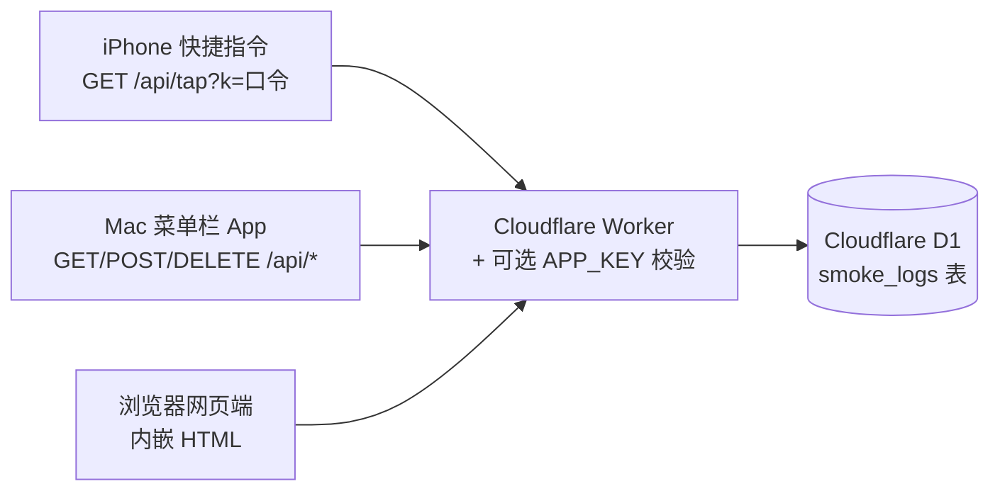

# SmokeLog · 抽烟记录

一套极简、自托管的吸烟记录工具：**点一下 +1，只记时间**，没有场景/情绪/备注那些负担。
数据全部存在你自己的 Cloudflare D1 里，任何第三方都看不到。

由三部分组成：

| 部分 | 说明 | 目录 |
|------|------|------|
| 🌐 网页端 | Cloudflare Worker 单文件版（页面 HTML 内嵌在 Worker 里，无需上传静态文件），手机/电脑浏览器直接用 | [`cloudflare/`](cloudflare/) |
| 🖥 Mac 菜单栏 App | SwiftPM + AppKit，菜单栏点烟图标记一根，左键 +1 / 右键面板（今日数、7 天柱状图、撤销） | [`mac/`](mac/) |
| 📱 iPhone 快捷指令 | 一键调用服务端打点接口，可绑定轻点背面 / Apple Watch / Siri | [`shortcuts/`](shortcuts/README.md) |

## 功能特性

- 一键记录：网页大圆圈、菜单栏图标、快捷指令、轻点背面，哪里顺手点哪里
- 记录后 4 秒内可撤销；今日/本周/本月根数统计 + 7 天柱状图
- 服务端打时间戳（`/api/tap`），快捷指令不需要处理任何时间逻辑
- 可选口令（`APP_KEY` 环境变量），设了才有访问权限
- 换域名/换服务器：Mac App 内齿轮设置里改地址即生效，不用重新编译
- 单文件部署：整个网页端就是一个 `worker.js`

## 架构



## 部署（Cloudflare）

### 方式一：纯网页端操作（无需命令行）

1. 登录 [Cloudflare Dashboard](https://dash.cloudflare.com/) → **Workers & Pages** → 创建 Worker，名字随意（如 `smoke-log`）。
2. **存储和数据库 → D1** → 创建数据库 `smoke-log`，进入后选「控制台」，粘贴执行 [`cloudflare/schema.sql`](cloudflare/schema.sql) 建表。
3. 回到 Worker → 「编辑代码」，把 [`cloudflare/worker.js`](cloudflare/worker.js) 全文粘贴进去，部署。
4. Worker → 设置 → 绑定：添加 **D1 数据库绑定**，变量名填 `DB`，选择刚建的 `smoke-log`。
5. （推荐）Worker → 设置 → 环境变量：添加 `APP_KEY`，值自己定一个口令。设了之后网页首次打开会弹密码框，API 调用需带 `?k=口令` 或请求头 `x-app-key`。
6. （可选）在 Worker 的「设置 → 域名和路由」绑定自定义域名。

### 方式二：Wrangler 命令行

```bash
npm install -g wrangler
wrangler login
wrangler d1 create smoke-log          # 把返回的 database_id 填进 wrangler.toml
cp cloudflare/wrangler.toml.example cloudflare/wrangler.toml
wrangler d1 execute smoke-log --file=./cloudflare/schema.sql --remote
wrangler deploy
```

## Mac 菜单栏 App

**下载安装（推荐）**：到 [Releases](https://github.com/opcoderen/smoke/releases) 下载 `SmokeLog-<版本>.dmg`，
双击打开，把 `SmokeLog.app` 拖进 `Applications` 即可。

> App 是 ad-hoc 签名（未走 Apple 付费开发者公证），首次打开若提示「无法验证开发者」：
> 在 Finder 里**右键 → 打开**，或执行 `xattr -dr com.apple.quarantine /Applications/SmokeLog.app`。

**从源码构建**（需要 Xcode Command Line Tools）：

```bash
cd mac
./build.sh        # 产出 build/SmokeLog.app（arm64 + x86_64 双架构）、SmokeLog-<版本>.dmg 和 .zip
```

**使用**：

1. 打开 App，菜单栏出现香烟图标；首次点击前先在面板里点齿轮设置：
   - 服务器地址：你部署的 Worker 域名（如 `https://your-domain.example.com`）
   - 密码：Worker 的 `APP_KEY`（没设就留空）
2. 左键点击图标 = 记一根；右键 = 打开面板（今日数、7 天柱状图、今日列表可删、可撤销）。
3. 密码只存在本机偏好设置里（`com.example.smokelog`），不上传、不用钥匙串。

## API

所有接口在设置了 `APP_KEY` 时需要鉴权：请求头 `x-app-key: <口令>` 或查询参数 `?k=<口令>`。

| 方法 | 路径 | 说明 |
|------|------|------|
| `GET` | `/api/tap` | 快速记录：服务端打当前时间戳（按 `TZ` 环境变量换算本地日期，默认 `Asia/Shanghai`）。供快捷指令 / Apple Watch 一键调用 |
| `GET` | `/api/logs?from=YYYY-MM-DD` | 查询记录（不传 `from` 返回最近 500 条） |
| `POST` | `/api/logs` | 手动补录，body：`{"local_date":"YYYY-MM-DD","smoked_at":"ISO8601"}` |
| `DELETE` | `/api/logs/:id` | 删除一条记录 |

## 数据结构

```sql
CREATE TABLE smoke_logs (
  id INTEGER PRIMARY KEY AUTOINCREMENT,
  local_date TEXT NOT NULL,      -- 按所在时区归日的日期
  smoked_at  TEXT NOT NULL,      -- ISO 8601 UTC 时间戳
  created_at TEXT NOT NULL DEFAULT (datetime('now'))
);
```

只记「什么时候抽了一根」，不记录任何个人信息。

## 目录结构

```
smokelog/
├── cloudflare/           # Worker 单文件版 + D1 建表语句 + wrangler 配置模板
│   ├── worker.js
│   ├── schema.sql
│   └── wrangler.toml.example
├── mac/                  # Mac 菜单栏 App（SwiftPM，无 Xcode 工程）
│   ├── Sources/SmokeLog/
│   ├── Resources/
│   ├── tools/makeicon.swift
│   ├── build.sh
│   └── Package.swift
└── shortcuts/            # iPhone 快捷指令搭建教程
    └── README.md
```

## 隐私

- 全部数据存在你自己的 Cloudflare D1，项目本身没有任何统计/上报。
- 仓库内所有域名均为占位示例（`your-domain.example.com`），请替换成自己的。

## License

[MIT](LICENSE)
